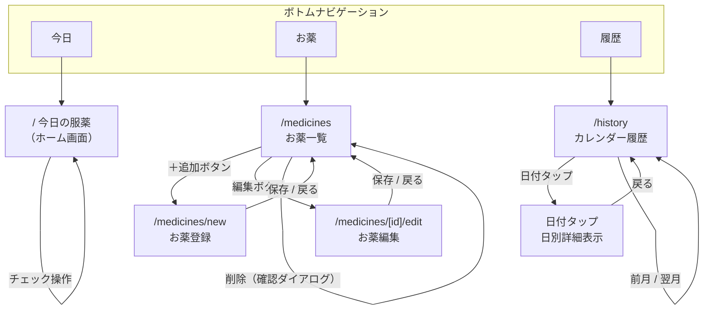
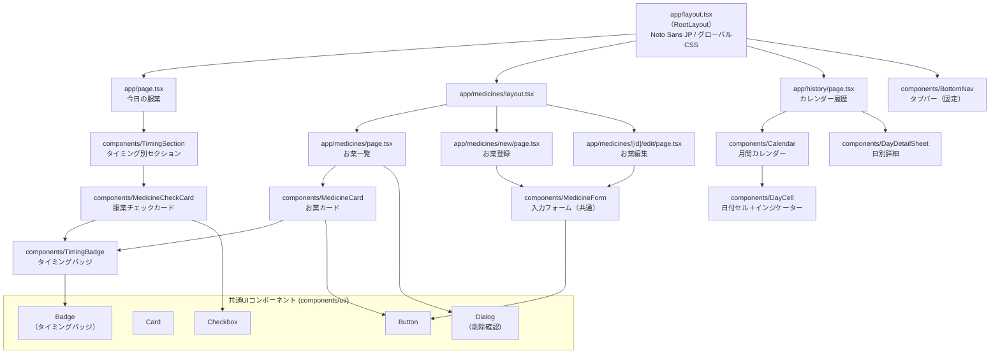
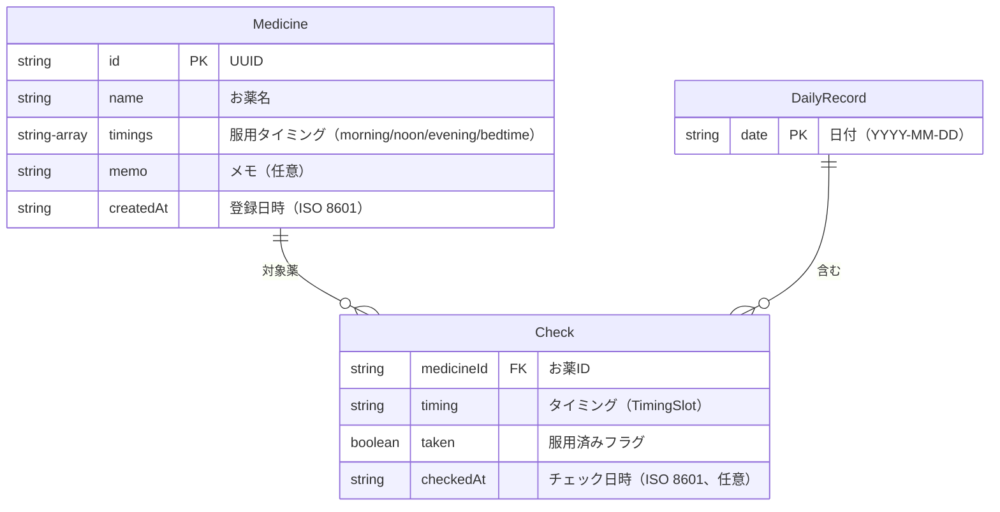
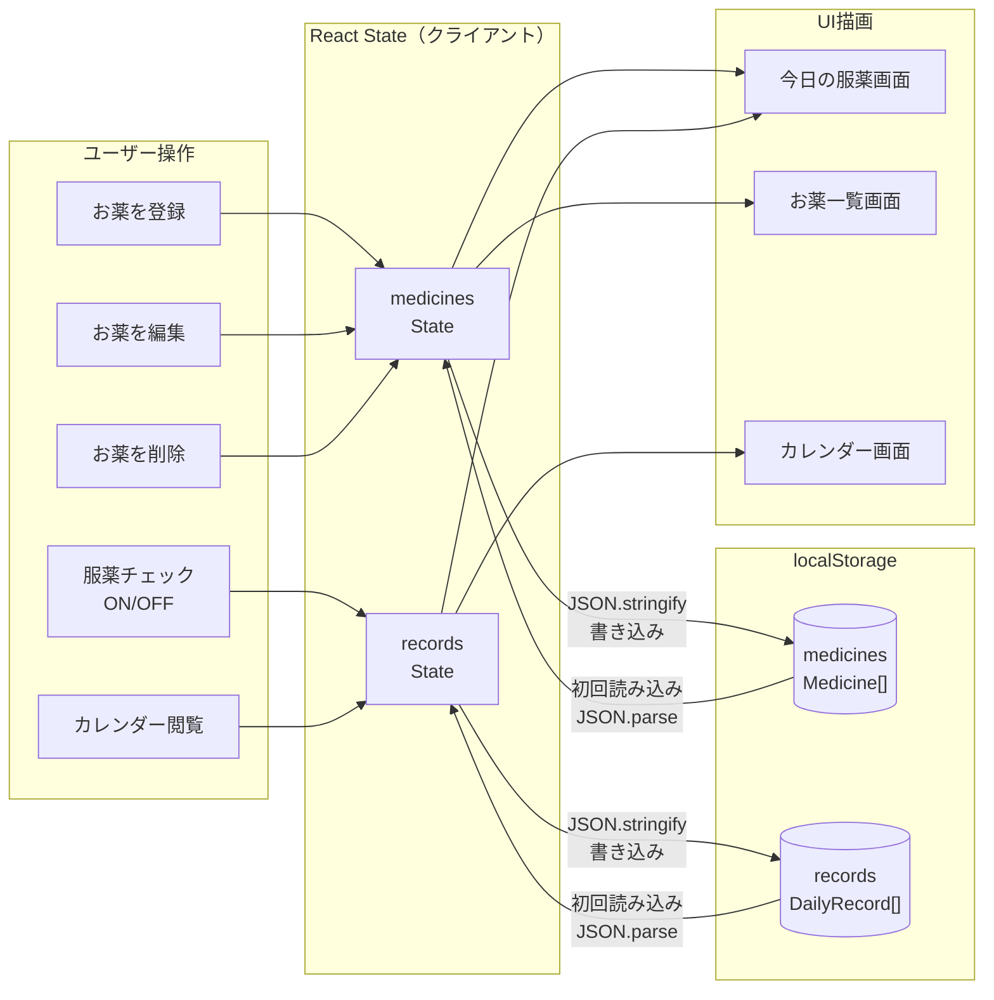

# アーキテクチャ設計図

## 1. 画面遷移図

## 2. コンポーネント構成図

## 3. ER図（データモデル）

### localStorage 保存構造

| キー | 型 | 説明 |
|------|------|------|
| `medicines` | `Medicine[]` | 登録済みお薬リスト |
| `records` | `DailyRecord[]` | 日次服薬記録リスト |

## 4. データフロー図

